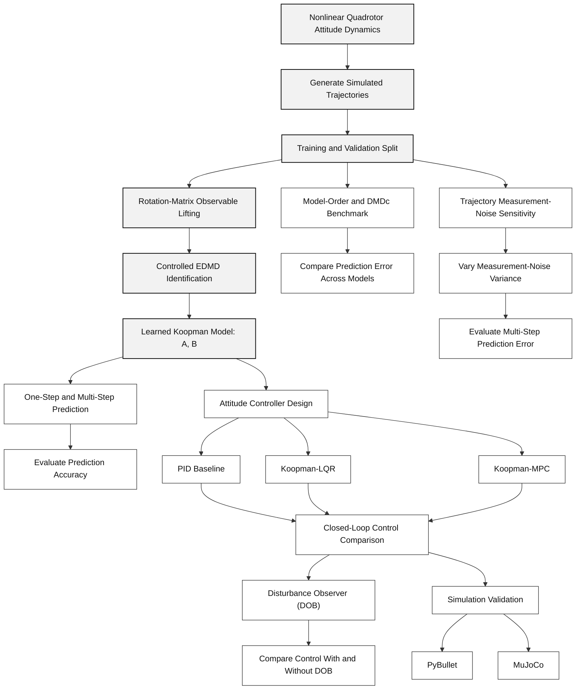
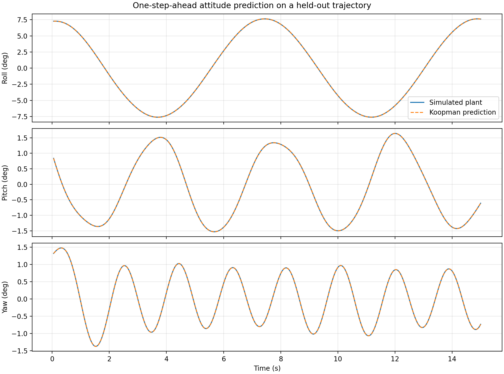
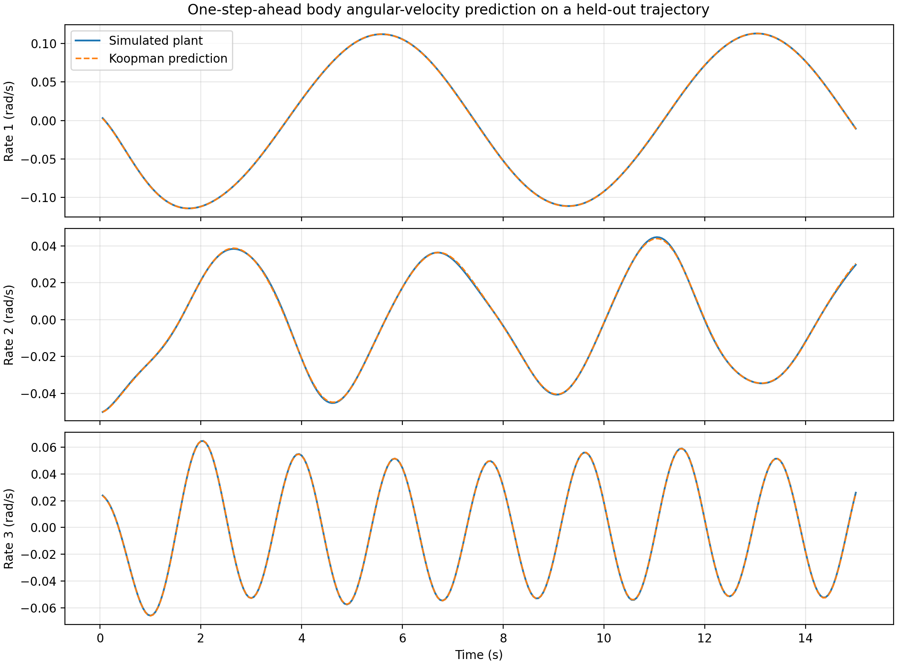
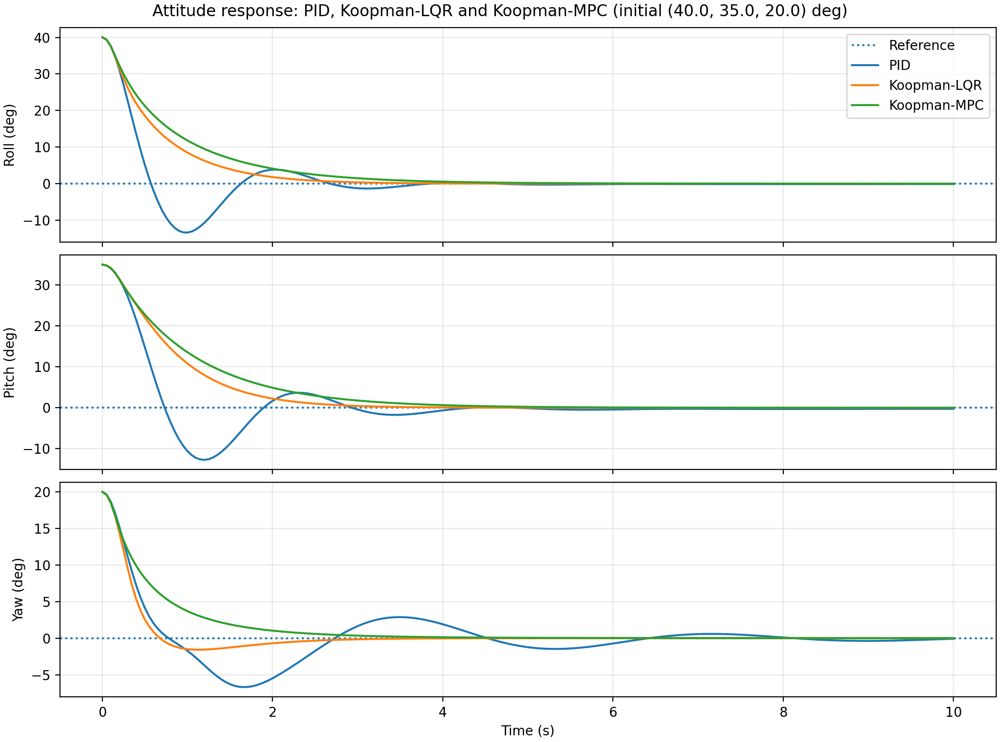
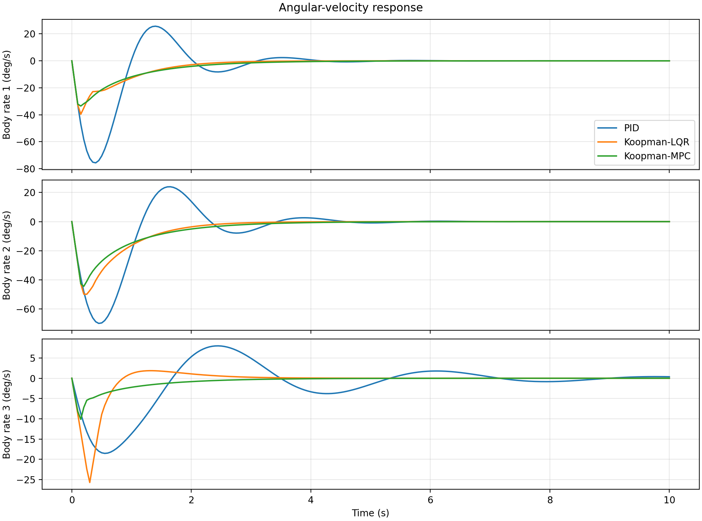
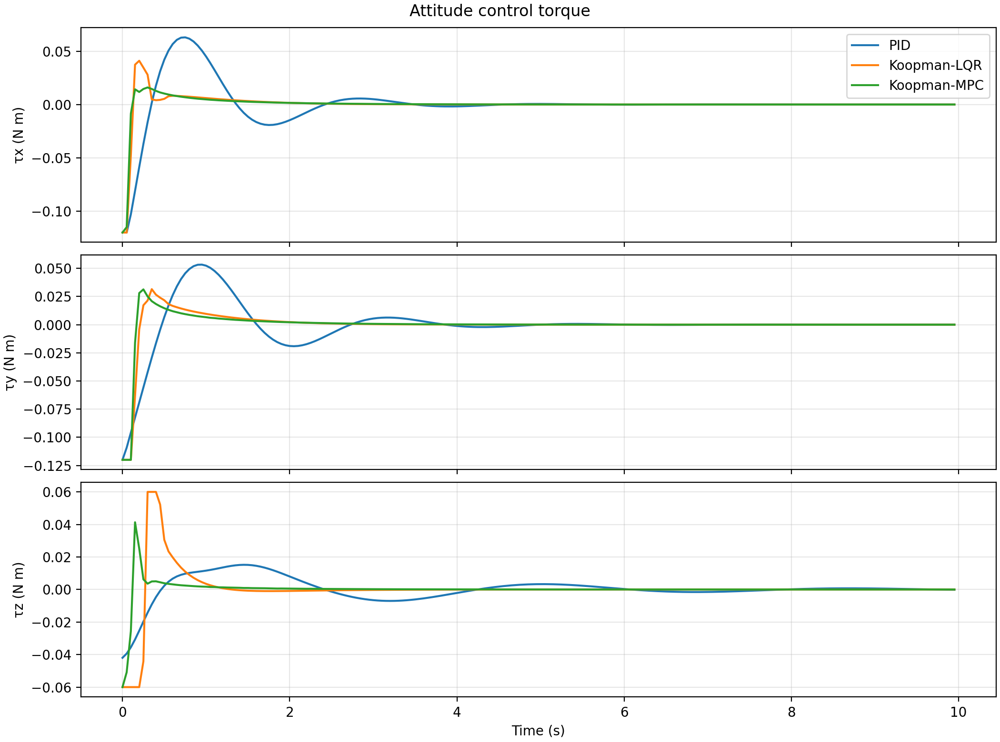
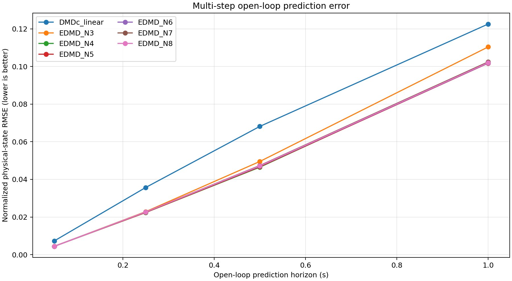

# Data-Driven Attitude Modeling and Control of Quadrotor UAVs Using the Koopman Operator

## Abstract

Quadrotor attitude control is challenging because rotational dynamics are nonlinear and coupled across roll, pitch, and yaw. This project develops a data-driven approach to attitude modeling and control using Koopman operator theory. Simulated trajectories generated from nonlinear rigid-body dynamics are used to construct a finite-dimensional observable representation and identify a linear controlled model using Extended Dynamic Mode Decomposition (EDMD). The identified model supports attitude prediction and feedback control through Koopman-based Linear Quadratic Regulator (LQR) and Model Predictive Control (MPC), with a conventional Proportional–Integral–Derivative (PID) controller serving as a baseline. The project evaluates prediction accuracy, closed-loop attitude response, and control effort, and investigates selected extensions involving DMD with control (DMDc) benchmarking, measurement-noise sensitivity, and disturbance-observer-based compensation. The results characterize the performance and limitations of the implemented methods under the evaluated simulation conditions.

## Introduction

Quadrotor Unmanned Aerial Vehicles (UAVs) are widely used in applications requiring agile and precise flight. Their attitude dynamics describe rotational motion about the roll, pitch, and yaw axes. These dynamics are nonlinear and coupled through the inertia properties, angular velocities, and applied control torques, making accurate modeling and reliable control important challenges.

Conventional model-based control methods rely on mathematical representations of the vehicle dynamics. Although these models provide physical insight, simplifying assumptions and model mismatch can affect their predictive accuracy. Purely data-driven approaches offer an alternative by learning system behavior from observed trajectories. However, an effective control-oriented model must represent the system's dynamics accurately while remaining suitable for prediction and controller design.

Koopman operator theory provides a framework for approximating nonlinear dynamics through the evolution of observable functions. By mapping the physical attitude state into a higher-dimensional observable space, the nonlinear system can be represented approximately by a finite-dimensional linear controlled model. Extended Dynamic Mode Decomposition (EDMD) is used to identify this model from trajectory data, enabling its use in prediction and feedback control.

This project implements a Koopman-based attitude modeling and control framework using simulated nonlinear quadrotor dynamics. The identified model is evaluated through held-out trajectory prediction and compared with a direct linear DMDc baseline. For closed-loop attitude regulation, Koopman-LQR and Koopman-MPC are compared with a conventional PID controller. Additional studies investigate model-order selection, identification under measurement noise, and disturbance-observer-based torque compensation. The overall objective is to assess the predictive and control capabilities of the implemented methods under clearly defined simulation conditions.

## Problem Statement

Quadrotor Unmanned Aerial Vehicle (UAV) attitude dynamics are nonlinear and strongly coupled across roll, pitch, and yaw, making accurate modeling and reliable control challenging. Conventional model-based approaches depend on mathematical assumptions and simplifications that may limit predictive accuracy, while purely data-driven approaches can produce models whose physical interpretation and closed-loop stability require careful evaluation. Direct linear models may fail to capture important nonlinear relationships, whereas Model Predictive Control (MPC) can introduce additional computational demands during online optimization.

Furthermore, simulated training trajectories do not fully represent the measurement uncertainty encountered in practical systems. Noise in attitude estimates, body angular velocities, and recorded control inputs can affect model identification and prediction accuracy. External torque disturbances can also cause deviations from the desired attitude, reducing control performance.

Therefore, a data-driven, control-oriented framework is required to approximate nonlinear quadrotor attitude dynamics, evaluate prediction accuracy, compare control strategies, and investigate the effects of measurement noise and external disturbances under controlled simulation conditions.

## Objectives

1. **Koopman-Based Attitude Modeling:** Develop a data-driven representation of nonlinear quadrotor attitude dynamics using Koopman observable functions and Extended Dynamic Mode Decomposition (EDMD).

2. **Model Identification and Prediction:** Identify a finite-dimensional linear controlled model from simulated trajectories and evaluate its one-step and multi-step prediction accuracy using held-out data.

3. **Controller Design and Comparison:** Implement Koopman-based Linear Quadratic Regulator (Koopman-LQR) and Model Predictive Control (Koopman-MPC), and compare their attitude-control performance against a conventional Proportional–Integral–Derivative (PID) controller.

4. **Model-Order and DMDc Benchmarking:** Evaluate different Koopman lifting orders and compare their prediction performance with a direct linear Dynamic Mode Decomposition with control (DMDc) baseline.

5. **Noise-Aware Identification:** Compare Least-Squares EDMD (LS-EDMD) with covariance-weighted Total Least-Squares EDMD (TLS-EDMD) under controlled measurement-noise conditions.

6. **Trajectory Measurement-Noise Sensitivity:** Assess how increasing measurement-noise variance affects Koopman model identification and multi-step open-loop prediction accuracy.

7. **Disturbance Estimation and Compensation:** Implement a filtered disturbance observer (DOB) to estimate additive rotational torque disturbances and evaluate its effect on PID, Koopman-LQR, and Koopman-MPC attitude tracking.

8. **Simulation Validation:** Evaluate the implemented controller interfaces in PyBullet and MuJoCo under documented simulation conditions, comparing attitude-tracking accuracy, settling behavior, and relevant control-performance metrics.

## Methodology

### Overall Methodology

The project follows a systematic workflow for data-driven quadrotor attitude modeling, prediction, control, and simulation-based evaluation. The nonlinear attitude dynamics are used to generate trajectory data, identify a finite-dimensional Koopman model, evaluate prediction accuracy, and compare different attitude controllers. Additional studies investigate model-order selection, measurement-noise sensitivity, and disturbance-observer-based compensation.

1. **Nonlinear Attitude Dynamics and Trajectory Generation:** Simulated trajectories are generated using the nonlinear rigid-body attitude dynamics of a quadrotor UAV. The collected data include the rotation matrix $R$, body angular velocity $\omega$, and control torque $u_k$. The corresponding attitude angles are denoted by roll $\phi$, pitch $\theta$, and yaw $\psi$. The trajectories are divided into training and validation sets to evaluate the identified model on unseen trajectories.

2. **Koopman Observable Lifting and Model Identification:** The system state $x_k$ is mapped into a higher-dimensional observable representation using the lift map $\Phi(x_k)$, constructed from rotation-matrix-based features. Extended Dynamic Mode Decomposition (EDMD) is used to identify the finite-dimensional linear model:

  ```math
\Phi(x_{k+1}) = A\Phi(x_k) + Bu_k
```

   where $A$ and $B$ are the identified system matrices, and $u_k$ is the control-torque input at sampling instant $k$.

3. **Model Prediction and Validation:** The identified Koopman model is evaluated using one-step and multi-step open-loop predictions on held-out trajectories. The predicted attitude and angular velocity are compared with their reference values using appropriate prediction-error metrics.

4. **Attitude Controller Design and Comparison:** Three controllers are evaluated: the conventional Proportional–Integral–Derivative (PID) controller, Koopman-based Linear Quadratic Regulator (Koopman-LQR), and Koopman-based Model Predictive Control (Koopman-MPC). Their performance is assessed through attitude-tracking response, settling behavior, control torque, and relevant computational and error metrics.

5. **Model-Order and DMDc Benchmarking:** Different lifting orders $N$ are evaluated to examine their effect on prediction accuracy. The Koopman-based model is also compared with a direct linear Dynamic Mode Decomposition with control (DMDc) baseline to assess the value of the lifted representation.

6. **Measurement-Noise Sensitivity:** Controlled levels of measurement noise are introduced into the trajectory data to investigate their effect on model identification and multi-step open-loop prediction. Prediction errors are compared across noise levels and prediction horizons.

7. **Disturbance Observer and Compensation:** A filtered Disturbance Observer (DOB) estimates external rotational torque disturbances. The estimated disturbance is used for compensation, and the performance of PID, Koopman-LQR, and Koopman-MPC is evaluated with and without disturbance compensation.

8. **Simulation Validation:** The implemented control methods are evaluated using PyBullet and MuJoCo simulation environments. The results are analyzed under the documented simulation conditions, accounting for differences between the simulator models and interfaces.

The complete workflow connects nonlinear trajectory generation, Koopman model identification, prediction validation, controller evaluation, the selected research studies, and simulation validation.


## Project Workflow

**Figure 1.** Overall project workflow illustrating simulated trajectory generation, Koopman model identification, prediction and controller evaluation, research extensions, and PyBullet and MuJoCo simulation validation.


### 1. Formulation of Nonlinear Quadrotor Attitude Dynamics (Newton–Euler Method)

The rotational motion of a quadrotor is described using two fundamental equations derived from the Newton–Euler method: **rotational kinematics** and **rotational dynamics**. Rotational kinematics describes how the vehicle's orientation changes over time, while rotational dynamics explains how torques and rotational coupling affect its angular velocity.

#### 1.1. Rotational Kinematics

The rotational kinematics equation is:

$$
\dot{R} = R\omega^\times
$$

This equation describes how the orientation of the quadrotor changes as it rotates. The rotation matrix $R$ represents the vehicle's orientation relative to the reference frame, while $\dot{R}$ represents the rate of change of that orientation.

The angular velocity vector $\omega$ describes the rotational motion about the three body axes. The matrix $\omega^\times$ is the skew-symmetric matrix associated with $\omega$, which expresses the vector cross product as a matrix operation.

It is defined as:

$$
\omega^\times =
\begin{bmatrix}
0 & -\omega_3 & \omega_2 \\
\omega_3 & 0 & -\omega_1 \\
-\omega_2 & \omega_1 & 0
\end{bmatrix}
$$

Here, $\omega_1$, $\omega_2$, and $\omega_3$ represent the components of the body-frame angular velocity.

**Interpretation:** Given the current orientation $R$ and angular velocity $\omega$, this equation determines how the quadrotor's orientation evolves over time.

#### 1.2. Rotational Dynamics

The rotational dynamics equation is:

$$
J\dot{\omega} = -\omega^\times J\omega + u + d(t)
$$

This equation describes how the quadrotor's angular velocity changes under the influence of control torques, rotational coupling, and external disturbances.

The inertia matrix $J$ represents the vehicle's resistance to angular acceleration. The term $\dot{\omega}$ denotes angular acceleration, while $J\dot{\omega}$ represents the inertial response to that acceleration.

The term $-\omega^\times J\omega$ accounts for rotational coupling, which arises because the quadrotor rotates about three body axes. The control torque $u$ represents the torque applied to regulate its rotational motion, and $d(t)$ represents external disturbances that can cause deviations from the desired attitude.

For a quadrotor whose body axes align with its principal axes of inertia, the inertia matrix can be represented as:

$$
J =
\begin{bmatrix}
J_{xx} & 0 & 0 \\
0 & J_{yy} & 0 \\
0 & 0 & J_{zz}
\end{bmatrix}
$$

where $J_{xx}$, $J_{yy}$, and $J_{zz}$ denote the moments of inertia about the three principal body axes.

**Interpretation:** This equation determines the angular acceleration resulting from the applied control torque, rotational coupling, and external disturbances.

#### 1.3. Combined Interpretation

The two equations describe complementary aspects of the quadrotor's rotational motion:

- **Rotational dynamics:** Determines how angular velocity $\omega$ changes in response to the applied torques and rotational coupling.
- **Rotational kinematics:** Uses angular velocity $\omega$ and the current orientation $R$ to determine how the orientation changes.

Together, these equations describe the nonlinear attitude dynamics of the quadrotor. They form the foundation for the subsequent Koopman-based modeling stage, in which trajectory data are used to identify a finite-dimensional linear representation of the nonlinear rotational system.

## 2. Nonlinear Attitude Dynamics and Koopman Representation

Koopman operator theory provides a way to represent the evolution of a nonlinear dynamical system using a linear operator acting on observable functions. To understand this idea, three concepts are introduced: the nonlinear dynamical system, observables, and the Koopman operator.

### 2.1. Nonlinear Dynamical System

The evolution of a discrete-time nonlinear dynamical system is expressed as:

$$
x_{t+1}=f(x_t)
$$

This equation describes how a system moves from its current state to its next state over time. The function $f(\cdot)$ determines the next state based on the current state and represents the system's state-transition rule.

**Understanding each term:**

- **$x_t$ — State vector:** Represents the state of the system at time $t$. In general, a state vector contains the variables required to describe the system at a particular instant.
- **$x_{t+1}$ — Next state vector:** Represents the state of the system at the next discrete time instant.
- **$f(\cdot)$ — Nonlinear state-transition function:** Defines how the current state determines the next state. It is called nonlinear when its relationship between the current and next states does not satisfy linearity.
- **$\mathcal{X}$ — State space:** The set of all possible states that the system can occupy.
- **$\mathbb{R}^n$ — $n$-dimensional real space:** Represents vectors containing $n$ real-valued components.

The state vector belongs to the state space:

$$
x_t\in\mathcal{X}\subseteq\mathbb{R}^n
$$

Here, $n$ denotes the dimension of the state vector.

**Interpretation:** In the quadrotor application, the rotational state evolves as the vehicle rotates. Its next state depends on its current rotational condition and the governing dynamics. Because these dynamics are nonlinear, directly describing their evolution with a linear model can be challenging.

### 2.2. Observable

An observable is a function that extracts a quantity of interest from the system's state. It is defined as:

$$
\psi:\mathcal{X}\rightarrow\mathbb{C}
$$

This notation means that the observable $\psi$ takes a state $x$ from the state space $\mathcal{X}$ and assigns a scalar value to it. The symbol $\mathbb{C}$ denotes the set of complex numbers.

For a particular state $x$, the observable is written as $\psi(x)$.

**Understanding each term:**

- **$\psi$ — Observable function:** A function that maps the system's state to a scalar observation.
- **$\psi(x)$ — Observable value:** The scalar quantity obtained by applying the observable function to the state $x$.
- **$\mathcal{X}$ — State space:** The set of possible states on which the observable is defined.
- **$\mathbb{C}$ — Complex-number space:** The set of numbers that can have real and imaginary components. An observable may also be real-valued, which is a special case.

The collection of observable functions is represented by $\mathcal{F}$, called the **space of observables**.

**Interpretation:** Instead of examining only the original state variables directly, Koopman theory examines functions of those variables. These functions provide an alternative representation of the system's behavior. The choice of observables is important because it influences how effectively the system's dynamics can be represented.

### 2.3. Koopman Operator

The Koopman operator describes how an observable evolves as the underlying system moves from one state to the next. Its defining relationship is:

$$
\psi(x_{t+1})=\psi(f(x_t))=\mathcal{K}\psi(x_t)
$$

This equation connects the nonlinear state-transition function with the evolution of an observable.

**Understanding the equation step by step:**

1. **$\psi(x_{t+1})$ — Observable at the next time instant:** Evaluates the observable using the next state of the system.

2. **$\psi(f(x_t))$ — Observable evaluated after the state transition:** Since $f(x_t)=x_{t+1}$, applying the observable to $f(x_t)$ gives the same result as applying it to the next state.

3. **$\mathcal{K}\psi(x_t)$ — Koopman operator applied to the observable:** The Koopman operator $\mathcal{K}$ advances the observable according to the system's dynamics.

The Koopman operator is expressed as a mapping from the space of observables back into itself:

$$
\mathcal{K}:\mathcal{F}\rightarrow\mathcal{F}
$$

This means that the operator takes an observable function and produces another observable function describing its evolution under the system dynamics.

**Why is the Koopman operator important?**

The key idea is that **the original system can be nonlinear, while the Koopman operator acting on observables is linear**. This allows linear-system techniques to be applied to the evolution of appropriately chosen observables, even when the underlying state-transition function $f(\cdot)$ is nonlinear.

In practical applications, the full Koopman operator may be infinite-dimensional. Therefore, a finite-dimensional approximation is typically constructed using selected observables and data-driven identification methods.

### 2.4. Connection to Quadrotor Attitude Modeling

These concepts provide the theoretical foundation for the Koopman-based modeling approach used in this project.

- The nonlinear state-transition function describes the evolution of the quadrotor's rotational state.
- Observable functions transform the state into a representation suitable for analyzing its evolution.
- The Koopman operator describes how these observables advance over time.

The next step is to construct a suitable finite-dimensional observable representation and identify its dynamics from simulated trajectory data. This produces a practical linear approximation that can be used for attitude prediction and controller design.

## 3. Koopman Lift Map and Vectorization

Koopman operator theory represents a nonlinear system using observable functions of its state. To construct a practical model for quadrotor attitude dynamics, the original state is mapped into a higher-dimensional representation called the **lifted state**. The lift map uses the rotation matrix and the body-frame angular velocity to construct this representation.

### 3.1. Lifted State

The nonlinear attitude state is mapped into a higher-dimensional observable space using the lift map $\Phi(x)$:

$$
\Phi(x) =
\begin{bmatrix}
\mathrm{vec}(R) \\
\mathrm{vec}(R\omega^\times) \\
\mathrm{vec}(R(\omega^\times)^2) \\
\vdots \\
\mathrm{vec}(R(\omega^\times)^{N-1})
\end{bmatrix}
$$

Equivalently, the lifted state consists of $N$ observable blocks, denoted by $\xi_1(x),\xi_2(x),\ldots,\xi_N(x)$. Each block is obtained from the rotation matrix $R$ and a corresponding matrix-power expression involving $\omega^\times$.

**Understanding each term:**

- **$x$ — Original state:** Represents the nonlinear attitude state of the quadrotor.
- **$\Phi(x)$ — Lift map representation:** The higher-dimensional vector obtained by transforming the original state into a collection of observable features.
- **$\xi_i(x)$ — Observable block:** The $i$-th group of features in the lifted representation.
- **$R$ — Rotation matrix:** Represents the orientation of the quadrotor.
- **$\omega^\times$ — Skew-symmetric matrix:** Represents the body-frame angular velocity $\omega$ in matrix form.
- **$(\omega^\times)^m$ — Matrix power:** Represents the $m$-th power of the matrix $\omega^\times$, obtained by repeatedly multiplying the matrix by itself. For example, $(\omega^\times)^2=\omega^\times\omega^\times$.
- **$N$ — Lift order:** Determines the number of observable blocks included in the lifted state. As specified in the slide, $N\geq 2$.

The first block is based on $R$, the second on $R\omega^\times$, and the subsequent blocks use increasing powers of $\omega^\times$.

**Why is lifting necessary?**

The original attitude dynamics are nonlinear and coupled. Rather than working only with the original state variables, the lift map constructs additional features that capture relationships between orientation and angular velocity. These features provide a representation in which the system's evolution can be approximated using a finite-dimensional linear model.

### 3.2. Vectorization

Vectorization is the operation of converting a matrix into a vector by arranging its elements in a specified order. In this project, each $3\times3$ matrix is converted into a nine-element vector.

Consider a general matrix:

$$
A=[a_{ij}]\in\mathbb{R}^{3\times3}
$$

Here, $A$ is a matrix containing nine elements, $a_{ij}$ denotes the element in row $i$ and column $j$, and $\mathbb{R}^{3\times3}$ represents the set of real-valued $3\times3$ matrices.

The vectorization operation is defined as:

$$
\mathrm{vec}(A)=
\begin{bmatrix}
a_{11} & a_{12} & a_{13} &
a_{21} & a_{22} & a_{23} &
a_{31} & a_{32} & a_{33}
\end{bmatrix}^{T}
$$

This operation arranges the matrix elements row by row into a single column vector. The notation $\mathrm{vec}(\cdot)$ denotes vectorization, and the superscript $T$ denotes the transpose, which turns the displayed row of elements into a column.

**Why is vectorization necessary?**

The rotation matrix $R$ and the matrix products involving $\omega^\times$ are each $3\times3$ matrices. Vectorization converts each matrix into a consistent nine-element vector, allowing these features to be stacked into a single lifted-state vector.

### 3.3. Dimension of the Lifted State

Each observable block is obtained by vectorizing a $3\times3$ matrix. Consequently, every block contributes nine scalar elements. Since the lifted state contains $N$ such blocks, its dimension is:

$$
\mathrm{dim}(\Phi(x))=9N
$$

Here, $$\mathrm{dim}(\Phi(x))$$ denotes the number of scalar elements in the lifted-state vector.

For example, when $N=5$:

$$
\mathrm{dim}(\Phi(x))=9\times5=45
$$

Therefore, the original attitude state is represented using a 45-dimensional lifted state when the lift order is five.

### 3.4. Connection to Koopman Model Identification

The lift map transforms the original attitude state into a vector of observable features. Vectorization ensures that each matrix-derived feature has a consistent vector representation, while the lift order $N$ determines the total dimension of the lifted state.

This representation is then used to identify the finite-dimensional Koopman model:

$$
\Phi(x_{k+1})=A\Phi(x_k)+Bu_k
$$

Here, $\Phi(x_k)$ and $\Phi(x_{k+1})$ are the lifted states at consecutive sampling instants, $u_k$ is the control-torque input, and $A$ and $B$ are the identified model matrices.

The resulting model approximates the evolution of the nonlinear attitude system through a linear relationship in the lifted space, enabling prediction and Koopman-based controller design.

## 4. Finite-Dimensional Koopman Model and Data Collection

After constructing the Koopman lift map, the next step is to represent the quadrotor's attitude dynamics in the lifted space and collect trajectory data for model identification. This section introduces the discrete-time Koopman model, its lifted-state representation, and the dataset used to learn the model from successive state and control-input measurements.

### 4.1. Linear Model in the Lifted Space

The finite-dimensional Koopman model is expressed as:

$$
\Phi(x_{k+1}) = A\Phi(x_k) + Bu_k
$$

Equivalently, the model can be written in compact form as:

$$
\Phi(x_{k+1}) =
K
\begin{bmatrix}
\Phi(x_k)\\
u_k
\end{bmatrix}
$$

where the combined matrix is defined as:

$$
K = [A \quad B]
$$

**Understanding the equation:**

- **$\Phi(x_k)$ — Current lifted state:** The observable representation of the quadrotor's attitude state at sampling instant $k$.
- **$\Phi(x_{k+1})$ — Next lifted state:** The predicted observable representation at the next sampling instant.
- **$u_k$ — Control input:** The control torque applied to the quadrotor at sampling instant $k$.
- **$A$ — State-transition matrix:** Describes how the current lifted state contributes to the next lifted state.
- **$B$ — Input matrix:** Describes how the applied control torque influences the next lifted state.
- **$K$ — Combined model matrix:** Combines $A$ and $B$ into one matrix for compact representation.
- **$T_s$ — Sampling period:** The time interval between consecutive data samples.

**How does the compact equation work?**

The matrix $K$ is formed by placing $A$ and $B$ side by side. The current lifted state and control input are stacked vertically into a single column vector. Multiplying these two expressions produces the same result as adding $A\Phi(x_k)$ and $Bu_k$.

The sampling instant $k$ identifies a discrete point in time, with consecutive samples separated by $T_s$. Therefore, the model predicts the lifted state at time $(k+1)T_s$ from the lifted state and control input at time $kT_s$.

**Why is this model important?**

The original attitude dynamics are nonlinear. The Koopman approach constructs a higher-dimensional observable representation in which their evolution can be approximated by a linear model. Once the matrices $A$ and $B$ have been identified from trajectory data, the model can be used for state prediction and Koopman-based controller design.

### 4.2. Lifted-State Representation

The lifted-state representation is defined as:

$$
\Gamma =
\begin{bmatrix}
R^T & z_1^T & z_2^T & z_3^T & \cdots
\end{bmatrix}^T
$$

where the observable blocks are defined by:

$$
z_i = R(\omega^\times)^i,
\qquad i=1,2,3,\ldots
$$

Here, $\Gamma$ denotes the stacked lifted representation, and each $z_i$ is an observable block constructed from the rotation matrix and a power of the skew-symmetric angular-velocity matrix.

**Understanding each term:**

- **$\Gamma$ — Lifted-state representation:** Collects the rotation-matrix-based features into a single representation of the system.
- **$R$ — Rotation matrix:** Represents the quadrotor's orientation.
- **$R^T$ — Transposed rotation matrix:** The transpose of $R$, used in the lifted-state notation shown in the formulation.
- **$z_i$ — Observable block:** A feature constructed from $R$ and the $i$-th power of $\omega^\times$.
- **$\omega^\times$ — Skew-symmetric matrix:** Represents the body-frame angular velocity $\omega$ in matrix form.
- **$i$ — Observable-block index:** Indicates which matrix power is used to construct a particular block.

For example, the first three observable blocks are:

$$
z_1 = R\omega^\times
$$

$$
z_2 = R(\omega^\times)^2
$$

$$
z_3 = R(\omega^\times)^3
$$

The lifted-state representation combines these features so that the evolution of the original rotational system can be analyzed through its observable variables.

### 4.3. Dynamics of the Lifted State

The lifted dynamics are expressed as:

$$
\dot{\Gamma} = C\Gamma + D\bar{u}
$$

where the effective input term is defined as:

$$
\bar{u} = -\omega^\times J\omega + u + d(t)
$$

**Understanding the equations:**

- **$\dot{\Gamma}$ — Rate of change of the lifted state:** Describes how the lifted representation evolves continuously over time.
- **$C$ — Lifted-state coefficient matrix:** Represents the contribution of the lifted state to its rate of change.
- **$D$ — Input coefficient matrix:** Represents how the effective input influences the lifted-state dynamics.
- **$\bar{u}$ — Effective input term:** Collects the rotational coupling term, applied control torque, and external disturbance torque.
- **$J$ — Inertia matrix:** Represents the quadrotor's rotational inertia.
- **$u$ — Applied control torque:** The torque used to regulate the quadrotor's rotational motion.
- **$d(t)$ — External disturbance torque:** Represents external effects that can alter the rotational motion.

The effective input $\bar{u}$ contains three contributions. The term $-\omega^\times J\omega$ represents rotational coupling, $u$ represents the commanded control torque, and $d(t)$ represents external disturbances.

The equation for $\dot{\Gamma}$ expresses the lifted-state evolution in terms of the coefficient matrices $C$ and $D$. It is a continuous-time representation, whereas the finite-dimensional Koopman predictor introduced in Section 4.1 is written in discrete time using the sampling period $T_s$.

**Why introduce the effective input?**

Grouping these contributions into $\bar{u}$ provides a compact representation of the lifted dynamics. It also distinguishes the commanded control torque $u$ from the combined torque-related terms affecting the rotational system.

### 4.4. Measured Dataset

The dataset is represented as:

The dataset is defined as:

```math
\mathrm{Data} = \{(x_k,u_k)\mid k=1,2,\ldots,M+1\}
```

This notation represents a collection of state and control-input samples recorded at successive sampling instants.

**Understanding each term:**

- **$\mathrm{Data}$ — Trajectory dataset:** The collection of recorded state and input information used for system identification.
- **$x_k$ — State sample:** The quadrotor's state at sampling instant $k$.
- **$u_k$ — Control-input sample:** The control torque associated with sampling instant $k$.
- **$k$ — Sampling index:** Identifies the position of a sample in the recorded trajectory.
- **$M$ — Sample-transition count notation:** The formulation uses $M$ to index the successive transitions formed from the recorded samples.

In this project, simulated quadrotor trajectories provide the state and control-input data. At each sampling instant, the trajectory records the system state and the corresponding control input. These samples preserve the relationship between the quadrotor's current condition, the applied torque, and its subsequent evolution.

Consecutive samples provide the information needed to construct the current and next lifted states, $\Phi(x_k)$ and $\Phi(x_{k+1})$. The corresponding control input $u_k$ is paired with that transition to identify the matrices $A$ and $B$.

### 4.5. Connection to Model Identification

The complete process connects data collection to the finite-dimensional Koopman model:

1. Collect successive state samples $x_k$ and control inputs $u_k$ from the simulated trajectories.
2. Apply the lift map to represent the states as $\Phi(x_k)$ and $\Phi(x_{k+1})$.
3. Pair each current lifted state with its control input and corresponding next lifted state.
4. Identify the matrices $A$ and $B$ from these input-output relationships.
5. Use the resulting model to predict the evolution of the lifted state and support controller design.

The identified model is therefore obtained from trajectory data rather than by directly deriving the finite-dimensional matrices from the full nonlinear equations. Its prediction accuracy can subsequently be evaluated using held-out trajectories.

## 5. EDMD Data Matrices and Least-Squares Identification

After collecting the trajectory data and defining the lift map, the next step is to identify the finite-dimensional Koopman model. Extended Dynamic Mode Decomposition (EDMD) uses the measured state transitions and control inputs to estimate the model matrix that best describes the evolution of the lifted state.

### 5.1. Data Matrices

The data used for identification are organized into two matrices, $P$ and $Q$.

The input data matrix $P$ is defined as:

$$
P =
\begin{bmatrix}
\Phi(x_1) & \Phi(x_2) & \cdots & \Phi(x_M) \\
u_1 & u_2 & \cdots & u_M
\end{bmatrix}
$$

The target data matrix $Q$ is defined as:

$$
Q =
\begin{bmatrix}
\Phi(x_2) & \Phi(x_3) & \cdots & \Phi(x_{M+1})
\end{bmatrix}
$$

Their dimensions are:

$$
P \in \mathbb{R}^{(9N+3)\times M},
\qquad
Q \in \mathbb{R}^{9N\times M}
$$

**Understanding the data matrices:**

- **$P$ — Input data matrix:** Contains the current lifted state $\Phi(x_i)$ and its associated control input $u_i$ for each sampled transition.
- **$Q$ — Target data matrix:** Contains the corresponding next lifted state $\Phi(x_{i+1})$ for every transition.
- **$x_i$ — Current state:** Represents the system state at sampling instant $i$.
- **$\Phi(x_i)$ — Current lifted state:** The higher-dimensional observable representation obtained by applying the Koopman lift map to $x_i$.
- **$u_i$ — Control input:** The control torque applied during the transition from $x_i$ to $x_{i+1}$.
- **$M$ — Number of transitions:** The number of consecutive state transitions included in the data matrices.
- **$N$ — Lift order:** Determines the dimension of the lifted state, which is $9N$ in the formulation used here.

The lifted state $\Phi(x_i)$ contains $9N$ elements, while the control input $u_i$ contains three torque components. Therefore, each column of $P$ contains $9N+3$ elements. Each column of $Q$ contains the $9N$ elements of the corresponding next lifted state.

**Why are there $M+1$ state samples but only $M$ transitions?**

A transition connects a current state to the next state. Thus, $M$ transitions require the sequence of states $x_1,x_2,\ldots,x_{M+1}$, together with the $M$ corresponding control inputs $u_1,u_2,\ldots,u_M$.

### 5.2. State-Transition Representation

Each column of the input matrix $P$ is paired with the corresponding column of the target matrix $Q$ to represent one state transition:

$$
\begin{bmatrix}
\Phi(x_i)\\
u_i
\end{bmatrix}
\longrightarrow
\Phi(x_{i+1})
$$

This means that the current lifted state and applied control input are used together to predict the next lifted state.

For example, the first column of $P$ contains $\Phi(x_1)$ and $u_1$, while the first column of $Q$ contains $\Phi(x_2)$. The second columns similarly represent the transition from $x_2$ to $x_3$, and this pairing continues through all $M$ transitions.

Collecting these transitions into matrices allows EDMD to estimate one model from the entire dataset rather than fitting a separate model to each transition.

### 5.3. EDMD Identification Using Least Squares

The finite-dimensional Koopman model is written as:

$$
\Phi(x_{k+1}) = A\Phi(x_k) + Bu_k
$$

For compact identification, the system and input matrices are combined into the matrix $K$:

$$
K = [A \quad B]
$$

Using the data matrices defined above, the model identification problem becomes:

The matrix $K$ is estimated by minimizing the least-squares error:

```math
K^\star = \arg\min_{K}\|Q-KP\|_2^2
```

This equation states that EDMD estimates the matrix $K$ by minimizing the difference between the measured next lifted states in $Q$ and the next lifted states predicted by $KP$.

**Understanding each term:**

- **$K$ — Combined model matrix:** Contains the identified matrices $A$ and $B$, which describe the contributions of the current lifted state and control input.
- **$KP$ — Predicted target data:** Represents the next lifted states predicted by applying the candidate model matrix $K$ to the input data matrix $P$.
- **$Q-KP$ — Prediction residual:** Represents the difference between the measured target data and the model predictions.
- **$\|\cdot\|_2^2$ — Squared norm:** Measures the size of the prediction mismatch using the norm specified in the formulation.
- **$\arg\min_K$ — Minimizing argument:** Identifies the value of $K$ that minimizes the objective function. In this context, it represents the matrix $K$ that produces the smallest possible least-squares error.

The matrix $K$ is divided into two blocks:

$$
K = [A \quad B]
$$

Here, $A$ maps the current lifted state to its contribution to the next lifted state, while $B$ maps the control input to its contribution.

**Why use least squares?**

The collected trajectory data generally contain many state transitions. A single estimated model must describe all of them as accurately as possible. Least squares provides a systematic way to find the model matrix that minimizes the overall prediction mismatch across the available data.

### 5.4. Equivalent Transition-Wise Formulation

The same identification objective can be expressed by summing the prediction errors over the individual transitions:

The Koopman model is identified by minimizing the least-squares prediction error:

```math
K^\star = \arg\min_{K}\sum_{i=1}^{M}
\left\|
\Phi(x_{i+1}) -
K
\begin{bmatrix}
\Phi(x_i)\\
u_i
\end{bmatrix}
\right\|_2^2
```
This equation expresses the matrix-based optimization as a collection of individual transition-prediction errors.

For each transition, the model receives the current lifted state $\Phi(x_i)$ and control input $u_i$, then predicts the next lifted state $\Phi(x_{i+1})$. The difference between the predicted and measured next lifted states is the residual for that transition.

The summation over $i=1,\ldots,M$ combines the residual errors from all transitions. Minimizing this accumulated error identifies a single matrix $K$ that fits the collected trajectory data.

The matrix and transition-wise formulations describe the same least-squares identification problem: one operates on the complete data matrices, while the other explicitly shows the contribution of each transition.

### 5.5. Outcome of EDMD Identification

The result of this process is the identified finite-dimensional Koopman model:

$$
\Phi(x_{k+1}) = A\Phi(x_k) + Bu_k
$$

The matrices $A$ and $B$ are estimated from the collected trajectory data rather than specified in advance. Once identified, the model can predict the evolution of the lifted state and serve as the basis for subsequent attitude prediction and Koopman-based controller design.

The accuracy of the identified model is then assessed using validation trajectories that were not used during identification.


### Least-Squares Derivation of the Controlled EDMD Model

The objective of controlled Extended Dynamic Mode Decomposition (EDMD) is to identify a matrix $K$ that predicts the next lifted state using the current lifted state and control input. The derivation below converts this prediction problem into a matrix equation that can be solved using linear algebra.

#### 1. Objective Function Over All Transitions

The least-squares objective is defined as:

```math
J(K) =
\sum_{k=1}^{M}
\left\|
\Phi(x_{k+1}) -
K
\begin{bmatrix}
\Phi(x_k)\\
u_k
\end{bmatrix}
\right\|_2^2
```

Here, $J(K)$ represents the total squared prediction error associated with a candidate model matrix $K$.

For each transition, the model uses the current lifted state $\Phi(x_k)$ and control input $u_k$ to predict the next lifted state $\Phi(x_{k+1})$. The difference between the actual and predicted lifted states is called the **prediction residual**.

The summation adds the squared prediction errors across all $M$ transitions. Minimizing $J(K)$ therefore means finding a model matrix that provides the best overall fit to the collected trajectory data in the least-squares sense.

#### 2. Expressing the Objective Using Data Matrices

Let $n$ denote the dimension of the lifted state and $m$ the dimension of the control input. Define the input and target data matrices as:

$$
P =
\begin{bmatrix}
\Phi(x_1) & \Phi(x_2) & \cdots & \Phi(x_M)\\
u_1 & u_2 & \cdots & u_M
\end{bmatrix}
$$

$$
Q =
\begin{bmatrix}
\Phi(x_2) & \Phi(x_3) & \cdots & \Phi(x_{M+1})
\end{bmatrix}
$$

Thus, $P\in\mathbb{R}^{(n+m)\times M}$ contains the current lifted states and corresponding control inputs, while $Q\in\mathbb{R}^{n\times M}$ contains the next lifted states. The unknown model matrix satisfies $K\in\mathbb{R}^{n\times(n+m)}$.

The predicted target matrix is $KP$, so the residual matrix is:

$$
E = Q-KP
$$

Here, $E$ collects the prediction residuals for all transitions into a single matrix.

The objective can then be written as:

$$
J(K)=\|Q-KP\|_F^2
$$

The notation $\|\cdot\|_F$ denotes the **Frobenius norm**, which measures the overall size of a matrix by taking the square root of the sum of the squares of all its elements. Its square is therefore the sum of the squared prediction residuals across all transitions and lifted-state components.

Using the trace, the objective becomes:

$$
J(K)=
\mathrm{tr}
\left[
(Q-KP)(Q-KP)^T
\right]
$$

Here, $\mathrm{tr}(\cdot)$ denotes the **trace operator**, which adds the diagonal elements of a square matrix. The superscript $T$ denotes matrix transpose.

This expression is useful because it represents the squared prediction error as a scalar function of the unknown matrix $K$, making differentiation with respect to $K$ straightforward.

#### 3. Expanding the Trace Expression

Expanding the matrix product gives:

$$
\begin{aligned}
J(K)
&=
\mathrm{tr}(QQ^T)
-\mathrm{tr}(QP^TK^T)\\
&\quad
-\mathrm{tr}(KPQ^T)
+\mathrm{tr}(KPP^TK^T)
\end{aligned}
$$

Using the transpose property of the trace, the two middle terms are equal. Combining them gives:

$$
\begin{aligned}
J(K)
&=
\mathrm{tr}(QQ^T)
-2\mathrm{tr}(QP^TK^T)\\
&\quad
+\mathrm{tr}(KPP^TK^T)
\end{aligned}
$$

The first term, $\mathrm{tr}(QQ^T)$, depends only on the measured target data and not on $K$. The second term captures the interaction between the target data and the candidate model matrix, while the third term is quadratic in $K$.

This expanded form makes the gradient of the objective with respect to $K$ easier to calculate.

#### 4. Differentiating With Respect to the Model Matrix

Differentiating the objective with respect to $K$ gives:

```math
\nabla_K J(K) = -2QP^T + 2KPP^T
```
Here, $\nabla_K J(K)$ denotes the matrix of partial derivatives of the objective with respect to the entries of $K$. It is called the **gradient** of the objective function.

The gradient describes how the objective changes as the entries of $K$ change. To obtain a least-squares minimizer, set the gradient equal to the zero matrix:

$$
-2QP^T+2KPP^T=0
$$

This is the first-order optimality condition for the least-squares problem. Since the objective is a convex quadratic function of $K$, satisfying this condition gives a global least-squares minimum.

#### 5. Obtaining the Normal Equation

Rearranging the zero-gradient equation gives:

$$
KPP^T=QP^T
$$

This is the **normal equation** for the least-squares problem.

Define the following matrices:

$$
G_1=\frac{1}{M}QP^T
$$

$$
G_2=\frac{1}{M}PP^T
$$

Here, $G_1$ summarizes the cross-correlations between the target data and the input data, while $G_2$ summarizes the correlations within the input data matrix.

Dividing the normal equation by $M$ gives:

$$
KG_2=G_1
$$

This compact form relates the unknown model matrix $K$ to quantities computed directly from the collected data.

#### 6. Solving Using the Moore–Penrose Pseudoinverse

A least-squares solution can be expressed using the **Moore–Penrose pseudoinverse**:

$$
K^\star=G_1G_2^\dagger
$$

Here, $(\cdot)^\dagger$ denotes the Moore–Penrose pseudoinverse, and $K^\star$ denotes the selected least-squares solution.

If $G_2$ is invertible, its pseudoinverse equals its ordinary inverse, and the solution simplifies to:

$$
K^\star=G_1G_2^{-1}
$$

However, $G_2$ may be singular or rank-deficient when the collected data do not independently represent all the features. In these cases, the pseudoinverse provides a minimum-Frobenius-norm least-squares solution without requiring an ordinary matrix inverse.

When the data are rank-deficient, other least-squares solutions may also exist. The pseudoinverse selects the solution with the smallest Frobenius norm. Its use does not guarantee an accurate predictive model if the data are insufficient or poorly informative, so validation remains essential.

#### 7. Recovering the Finite-Dimensional Koopman Model

Once $K^\star$ has been identified, partition it into the state-transition matrix $A$ and the control-input matrix $B$:

$$
K^\star=
\begin{bmatrix}
A & B
\end{bmatrix}
$$

Here, $A\in\mathbb{R}^{n\times n}$ describes the contribution of the current lifted state, while $B\in\mathbb{R}^{n\times m}$ describes the contribution of the control input.

Substituting this partition into the identified model gives:

$$
\boxed{
\Phi(x_{k+1})=A\Phi(x_k)+Bu_k
}
$$

This is the final finite-dimensional linear model in the lifted space. Although the original quadrotor attitude dynamics are nonlinear, the identified model describes their evolution through a linear relationship in the chosen lifted representation.

The main result of the derivation is that the unknown model matrices can be estimated directly from collected state-transition data by solving a least-squares problem. The identified model can then be evaluated on held-out trajectories and used for Koopman-based attitude prediction and controller design.


## 7. Koopman-Based LQR Controller

After identifying the finite-dimensional Koopman model, the next step is to design a controller that regulates the quadrotor's attitude. Linear Quadratic Regulator (LQR) control determines the control torque by balancing deviations in the lifted state against the effort required to apply the control input.

### 7.1. Feedback Control Law

For the identified lifted linear system, the feedback control law is:

$$
u_k = -\Omega_{\mathrm{LQR}}\Phi(x_k)
$$

This equation determines the control torque applied at sampling instant $k$ based on the current lifted state.

**Understanding each term:**

- **$u_k$ — Control input:** The torque command applied to the quadrotor at sampling instant $k$.
- **$\Phi(x_k)$ — Lifted state:** The higher-dimensional observable representation of the current attitude state.
- **$\Omega_{\mathrm{LQR}}$ — Optimal LQR feedback gain:** A matrix that determines how the lifted state contributes to the control command.
- **Negative sign:** Indicates feedback in the direction that counteracts the state deviation represented by the feedback law.

The feedback gain is calculated using the identified model matrices $A$ and $B$ and the solution of the discrete algebraic Riccati equation, as described in Section 8.

**How does the feedback law work?**

The controller evaluates the current lifted state and multiplies it by the feedback gain. The resulting control command is applied with a negative sign to regulate the system's response. As the state evolves, the controller recalculates the control input at subsequent sampling instants.

In simple terms, LQR determines how much corrective torque to apply based on the current state and the designed feedback gain.

### 7.2. Quadratic Cost Function

LQR selects a feedback law by minimizing a quadratic cost function over time:

$$
J =
\sum_{k=0}^{\infty}
\left[
\Phi(x_k)^T\bar{Q}\Phi(x_k)
+
u_k^TRu_k
\right]
$$

This cost function measures two things: the deviation represented by the lifted state and the effort required to apply the control input.

**Understanding the two terms:**

1. **Lifted-state cost, $\Phi(x_k)^T\bar{Q}\Phi(x_k)$:** Penalizes the state components selected and weighted by $\bar{Q}$. A larger penalty on a state component makes deviations in that component more costly to the controller's optimization.

2. **Control-effort cost, $u_k^TRu_k$:** Penalizes the magnitude of the control input. Increasing this penalty encourages the controller to avoid unnecessarily large torque commands.

The summation from $k=0$ to infinity represents the accumulated cost over the entire future evolution of the discrete-time system. The controller seeks a feedback law that minimizes this cost.

The lifted-state weighting matrix is defined as:

$$
\bar{Q} =
\begin{bmatrix}
Q & 0\\
0 & 0
\end{bmatrix}
$$

Here, $Q$ specifies the weighting of the selected state components, while the zero blocks indicate that the corresponding components in this block representation are not directly penalized by this state-cost term.

The weighting matrices satisfy:

$$
Q = Q^T \geq 0,
\qquad
R = R^T > 0
$$

These conditions mean that $Q$ is symmetric positive semidefinite and $R$ is symmetric positive definite.

- **Symmetric:** A matrix equals its transpose.
- **Positive semidefinite:** The associated quadratic form is nonnegative, so the state penalty cannot be negative.
- **Positive definite:** The associated quadratic form is strictly positive for every nonzero input, so nonzero control effort receives a positive penalty.

In this LQR formulation, $R$ denotes the control-effort weighting matrix. It is distinct from the rotation matrix $R$ used in the earlier attitude-dynamics equations; the meaning is determined by the equation in which the symbol appears.

**How does the cost function affect control?**

The relative weights assigned to state deviation and control effort influence the controller's behavior. Increasing the state penalty relative to the input penalty encourages stronger corrective action, whereas increasing the input penalty discourages large control commands.

The LQR formulation therefore provides a systematic way to balance attitude-state regulation and control effort.

---

## 8. Riccati Equation and Optimal Control Gain

The feedback gain $\Omega_{\mathrm{LQR}}$ is not chosen arbitrarily. It is calculated from the identified lifted linear model by solving the discrete algebraic Riccati equation (DARE).

### 8.1. Discrete Algebraic Riccati Equation

For the controllable pair $(A,B)$, the discrete algebraic Riccati equation is:

```math
P = A^T P A
- A^T P B \left(R + B^T P B\right)^{-1} B^T P A
+ \bar{Q}
```

This equation determines the matrix $P$ used to calculate the optimal LQR feedback gain.

**Understanding each term:**

- **$A$ — Lifted-state transition matrix:** Describes how the current lifted state contributes to the next lifted state.
- **$B$ — Control-input matrix:** Describes how the applied control input affects the next lifted state.
- **$P$ — Riccati solution matrix:** Represents the cost-to-go weighting associated with the optimal control problem.
- **$\bar{Q}$ — Lifted-state weighting matrix:** Specifies how deviations in the selected state components are penalized.
- **$R$ — Control-effort weighting matrix:** Specifies the penalty assigned to the control input.
- **$(R+B^TPB)^{-1}$ — Inverse matrix term:** Appears in the optimal-control calculation and accounts for the effect of the input penalty and future state cost.

Here, $P$ denotes the Riccati solution matrix, not the EDMD input data matrix named $P$ in Section 5.

**What does the Riccati equation accomplish?**

The equation accounts for the present state penalty, the effect of the control input, and the future cost associated with the system's evolution. Solving it provides the information required to calculate the feedback gain that minimizes the quadratic cost for the identified linear system under the applicable LQR conditions.

The term *algebraic* indicates that the equation is solved for a matrix $P$ that satisfies the equation itself, rather than integrating a differential Riccati equation over time.

### 8.2. Optimal LQR Feedback Gain

Once the Riccati equation has been solved, the optimal feedback gain is calculated as:

```math
\Omega_{\mathrm{LQR}} =
\left(R+B^T P B\right)^{-1}B^T P A
```

This equation combines the identified system matrices, the control-effort weighting matrix, and the Riccati solution to determine how the lifted state should influence the control command.

The resulting matrix $\Omega_{\mathrm{LQR}}$ is then substituted into the feedback control law:

$$
u_k = -\Omega_{\mathrm{LQR}}\Phi(x_k)
$$

This produces the control input used by the LQR controller at each sampling instant.

**The calculation follows three main steps:**

1. Use the identified matrices $A$ and $B$, together with $\bar{Q}$ and $R$, to solve the discrete algebraic Riccati equation for $P$.
2. Substitute $P$, $A$, $B$, and $R$ into the feedback-gain equation to calculate $\Omega_{\mathrm{LQR}}$.
3. Apply the feedback law to the current lifted state $\Phi(x_k)$ to obtain the control input $u_k$.

The identified model and weighting matrices therefore determine the feedback gain, while the current lifted state determines the control input at each step.

### 8.3. Complete Mathematical Framework

The complete Koopman-based LQR workflow can be summarized as:

$$
\boxed{
\text{Nonlinear Dynamics}
\rightarrow
\text{Koopman Lift}
\rightarrow
\text{EDMD}
\rightarrow
K=[A\quad B]
\rightarrow
\text{LQR}
\rightarrow
\Omega_{\mathrm{LQR}}
\rightarrow
u_k
}
$$

The nonlinear attitude dynamics provide the trajectory data. The Koopman lift map transforms the state into a higher-dimensional observable representation, and EDMD identifies the model matrix $K$, which is partitioned into $A$ and $B$.

The LQR design then uses these identified matrices and the quadratic cost weights to solve the Riccati equation and calculate $\Omega_{\mathrm{LQR}}$. Finally, the feedback law uses this gain to compute the control torque $u_k$.

**In summary:** Koopman-based LQR combines data-driven model identification with optimal feedback control. EDMD provides the finite-dimensional lifted model, and LQR uses that model to calculate a feedback gain that balances state regulation against control effort.

### Figure 2. One-Step-Ahead Attitude Prediction



*Figure 2. One-step-ahead attitude prediction using the identified Koopman model on a held-out trajectory.*

**What the figure shows**

Figure 2 evaluates the predictive accuracy of the identified Koopman model by comparing the simulated plant's attitude angles with the corresponding model predictions on a held-out trajectory. The figure contains three plots showing roll, pitch, and yaw over approximately 15 seconds.

- **Roll ($\phi$):** The upper plot shows the roll angle in degrees. The Koopman prediction closely follows the simulated plant through repeated oscillations, capturing the peaks, troughs, and changes in direction.
- **Pitch ($\theta$):** The middle plot shows the pitch angle in degrees. The predicted curve closely matches the simulated plant's changing pitch angle, capturing its oscillatory behavior with only small visible differences.
- **Yaw ($\psi$):** The lower plot shows the yaw angle in degrees. The predicted curve follows the changing yaw oscillations, including variations in amplitude and the transitions between positive and negative angles.


The horizontal axis represents time in seconds, while the vertical axes represent the corresponding attitude angles in degrees. The solid blue curve denotes the *Simulated plant*, which provides the reference response, and the orange dashed curve denotes the *Koopman prediction*.

The two curves overlap closely across all three attitude components. This visual agreement indicates that the identified model captures the attitude evolution accurately for the evaluated trajectory under the one-step-ahead prediction setup.

**What is one-step-ahead prediction?**

At each sampling instant, the identified model uses the current lifted state $\Phi(x_k)$ and control input $u_k$ to predict the next lifted state:

$$
\Phi(x_{k+1}) = A\Phi(x_k) + Bu_k
$$

The predicted lifted state is then used to obtain the corresponding attitude prediction for comparison with the simulated plant. In one-step-ahead evaluation, each prediction uses the current state information at that step rather than relying exclusively on the previous prediction to generate the entire future trajectory.

**Key observation**

The close overlap between the simulated plant and Koopman prediction demonstrates strong one-step-ahead attitude prediction agreement on this held-out trajectory. This supports the effectiveness of the identified Koopman model in capturing the rotational behavior represented by the evaluated data.


### Figure 3. One-Step-Ahead Body Angular-Velocity Prediction



*Figure 3. One-step-ahead prediction of the three body angular-velocity components using the learned Koopman model on a held-out trajectory.*

**What the figure demonstrates**

Figure 3 evaluates how accurately the identified Koopman model predicts the quadrotor's body-frame angular velocity on a held-out trajectory that was not used to identify the model. The three subplots show the angular-velocity components over approximately 15 seconds.

- **Rate 1 ($\omega_1$):** The upper plot shows oscillatory motion, with angular velocity varying approximately between $-0.115$ and $0.112$ rad/s. The Koopman prediction closely follows the simulated plant through the positive and negative peaks.
- **Rate 2 ($\omega_2$):** The middle plot shows variations in the second angular-velocity component, including changes in amplitude and direction. The predicted curve closely matches the reference response, including its successive peaks and troughs.
- **Rate 3 ($\omega_3$):** The lower plot shows more frequent oscillations than the other two components. The Koopman model captures these repeated variations and follows the simulated plant across the displayed time interval.

**How to interpret the curves**

The horizontal axis represents time in seconds, and the vertical axes represent body-frame angular velocity in radians per second ($\mathrm{rad/s}$).

The solid blue curve represents the **Simulated plant**, which provides the reference response. The orange dashed curve represents the **Koopman prediction**. Across all three components, the curves overlap closely, indicating that the model reproduces the angular-velocity variations with small visible prediction differences.

**Connection to the identified Koopman model**

The model predicts the next lifted state using the current lifted state and control input:

$$
\Phi(x_{k+1}) = A\Phi(x_k) + Bu_k
$$

The predicted lifted state is used to obtain the corresponding body angular-velocity prediction for comparison with the simulated plant.

Body angular velocity is important because it describes how quickly the quadrotor rotates about its body axes. Predicting these components accurately helps characterize the rotational dynamics that underpin attitude prediction and controller design.

**Key observation**

The close agreement between the simulated plant and the Koopman prediction across all three angular-velocity components provides evidence that the identified model captures the rotational motion represented in this held-out trajectory.

This figure evaluates **one-step-ahead prediction**, not an uninterrupted open-loop rollout over the entire 15-second interval. Therefore, the result supports one-step prediction accuracy but does not, by itself, establish long-horizon prediction accuracy, closed-loop stability, or superior controller performance.

### Figure 4. Attitude Response of PID, Koopman-LQR, and Koopman-MPC Controllers



*Figure 4. Attitude response of PID, Koopman-LQR, and Koopman-MPC controllers under a zero-attitude reference.*

**What the figure demonstrates**

Figure 4 compares the closed-loop attitude responses of three controllers: conventional Proportional–Integral–Derivative (PID), Koopman-based Linear Quadratic Regulator (Koopman-LQR), and Koopman-based Model Predictive Control (Koopman-MPC). The quadrotor starts from an initial attitude of $(40^\circ, 35^\circ, 20^\circ)$ for roll, pitch, and yaw, respectively. All three controllers aim to bring the attitude angles to the zero reference.

The figure contains three subplots, showing the evolution of roll, pitch, and yaw over approximately 10 seconds. The dotted reference line represents the desired attitude of $0^\circ$, while the colored curves show the responses of the three controllers.

#### 1. Roll Response

The upper plot shows how each controller regulates the roll angle from an initial value of $40^\circ$ toward the zero reference.

- **PID:** The roll angle decreases rapidly, crosses the reference, and reaches a substantial negative overshoot before recovering. It exhibits a damped oscillatory response as it approaches zero.
- **Koopman-LQR:** The response decreases more smoothly, with considerably less overshoot than PID. It approaches the reference without the pronounced oscillation observed in the PID response.
- **Koopman-MPC:** The response is smooth and largely avoids overshoot, but its convergence is slower than that of Koopman-LQR in this plot.

**Interpretation:** Koopman-LQR provides a favorable balance between convergence speed and overshoot for the displayed roll response, while Koopman-MPC produces a smoother but slower response.

#### 2. Pitch Response

The middle plot shows the pitch angle moving from an initial value of $35^\circ$ toward zero.

- **PID:** The pitch angle crosses the reference and develops a pronounced negative overshoot before returning toward zero.
- **Koopman-LQR:** The response approaches zero more smoothly, with much less overshoot than PID.
- **Koopman-MPC:** The pitch angle decreases gradually toward the reference, with a smooth response and little visible overshoot, although convergence is slower than Koopman-LQR in this plot.

**Interpretation:** The displayed pitch response shows that the Koopman-based controllers reduce the pronounced undershoot present in the PID response. Koopman-LQR converges more quickly than Koopman-MPC in the illustrated case.

#### 3. Yaw Response

The lower plot shows yaw regulation from an initial angle of $20^\circ$ toward the zero reference.

- **PID:** The yaw angle crosses zero, develops a negative overshoot, and continues oscillating around the reference before settling.
- **Koopman-LQR:** The response exhibits a relatively small negative deviation and then approaches zero with limited oscillation.
- **Koopman-MPC:** The yaw angle decreases smoothly toward zero, with little visible overshoot, but takes longer to converge than Koopman-LQR.

**Interpretation:** Koopman-LQR reduces the oscillatory behavior visible in the PID response, while Koopman-MPC provides a smooth, gradual approach to the desired yaw angle.

#### Overall Comparison

The figure highlights three important aspects of closed-loop attitude control:

1. **Convergence speed:** Koopman-LQR approaches the zero-attitude reference relatively quickly across the three displayed axes. Koopman-MPC follows a smoother but generally slower response.
2. **Overshoot and oscillation:** PID responds rapidly but exhibits larger overshoots and more oscillations, especially in roll and pitch. Both Koopman-based controllers reduce these effects in the displayed responses.
3. **Attitude regulation:** All three controllers drive roll, pitch, and yaw toward the zero reference, although their transient behaviors differ.

**Key observation**

For this initial attitude and zero-reference test, Koopman-LQR demonstrates a favorable compromise between convergence speed and overshoot. Koopman-MPC provides smooth responses with limited overshoot but generally slower convergence, while PID exhibits more pronounced transient oscillations.

These observations apply to the specific simulation conditions shown in Figure 4. A definitive controller ranking requires quantitative metrics, such as settling time, overshoot, attitude RMSE, and control effort, evaluated consistently across the tested conditions.

### Figure 5. Angular-Velocity Response of PID, Koopman-LQR, and Koopman-MPC Controllers



*Figure 5. Angular-velocity response of PID, Koopman-LQR, and Koopman-MPC controllers.*

**What the figure demonstrates**

Figure 5 compares the body-frame angular-velocity responses of three controllers: conventional Proportional–Integral–Derivative (PID), Koopman-based Linear Quadratic Regulator (Koopman-LQR), and Koopman-based Model Predictive Control (Koopman-MPC). The three subplots show how the angular-velocity components evolve over 10 seconds as the controllers regulate the quadrotor toward its desired attitude.

The horizontal axis represents time in seconds, and the vertical axes represent angular velocity in degrees per second ($^\circ/\mathrm{s}$). The three components are denoted by $\omega_1$, $\omega_2$, and $\omega_3$, corresponding to rotation about the quadrotor's body axes.

#### 1. Body Angular-Velocity Component 1 ($\omega_1$)

The upper plot compares the first body angular-velocity component.

- **PID:** The response exhibits a substantial negative peak, reaching approximately $-76^\circ/\mathrm{s}$, followed by a positive overshoot of approximately $+26^\circ/\mathrm{s}$. It then oscillates before gradually converging toward zero.
- **Koopman-LQR:** The angular velocity reaches approximately $-40^\circ/\mathrm{s}$ and then approaches zero with considerably less oscillation than PID.
- **Koopman-MPC:** The response reaches approximately $-33^\circ/\mathrm{s}$ and gradually converges toward zero with a smooth, damped response.

**Interpretation:** Both Koopman-based controllers substantially reduce the large angular-velocity excursions observed with PID in this component. Koopman-MPC exhibits the smallest initial negative peak in the displayed response.

#### 2. Body Angular-Velocity Component 2 ($\omega_2$)

The middle plot shows the second angular-velocity component.

- **PID:** The response reaches approximately $-70^\circ/\mathrm{s}$, followed by a positive overshoot of around $+24^\circ/\mathrm{s}$ before the oscillations decay.
- **Koopman-LQR:** The response reaches approximately $-50^\circ/\mathrm{s}$ and approaches zero smoothly.
- **Koopman-MPC:** The response reaches approximately $-45^\circ/\mathrm{s}$ and also converges toward zero with limited oscillation.

**Interpretation:** The Koopman-based controllers produce less extreme angular-velocity excursions than PID in this component. Koopman-MPC shows a slightly smaller negative peak than Koopman-LQR in the plotted response.

#### 3. Body Angular-Velocity Component 3 ($\omega_3$)

The lower plot shows the third angular-velocity component.

- **PID:** The response initially decreases to approximately $-18.5^\circ/\mathrm{s}$, then overshoots positively to around $+8^\circ/\mathrm{s}$ before oscillating toward zero.
- **Koopman-LQR:** The response exhibits a sharper initial negative peak of approximately $-26^\circ/\mathrm{s}$ before recovering and gradually approaching zero.
- **Koopman-MPC:** The response reaches approximately $-10^\circ/\mathrm{s}$ and then approaches zero with a relatively smooth trajectory.

**Interpretation:** Koopman-MPC produces the smallest initial angular-velocity excursion in this component. Koopman-LQR also converges toward zero, but its initial transient is more pronounced here. This illustrates that controller performance can differ across individual body axes.

#### Overall Comparison

The figure highlights three important observations:

1. **Transient angular velocity:** PID exhibits large initial angular-velocity excursions and pronounced oscillations in the first two components. The Koopman-based controllers reduce these excursions in the displayed responses.
2. **Damping behavior:** The angular-velocity oscillations associated with PID take longer to decay, whereas the Koopman-based responses are generally smoother and more strongly damped.
3. **Axis-dependent performance:** Koopman-MPC has the smallest initial excursion in the third component and slightly smaller negative peaks than Koopman-LQR in the first two components. However, the relative performance varies across the axes.

**Key observation**

For this simulation, both Koopman-based controllers demonstrate smoother angular-velocity regulation than PID across the first two body axes. Koopman-MPC also exhibits a smaller initial excursion in the third component, while Koopman-LQR has a more pronounced transient in that component.

These angular-velocity responses complement Figure 4, which compares the attitude angles. Angular velocity describes how rapidly the quadrotor rotates, whereas attitude describes its orientation. Evaluating both helps assess the transient behavior of the attitude-control system.

The visual comparison alone does not establish an overall best controller. A quantitative ranking requires supporting metrics such as peak angular velocity, settling time, attitude-tracking error, and control effort under consistent simulation conditions.

### Figure 6. Comparison of Attitude-Control Torque Commands



*Figure 6. Comparison of attitude-control torque commands under PID, Koopman-LQR, and Koopman-MPC controllers.*

**What the figure demonstrates**

Figure 6 compares the control torques generated by the PID, Koopman-LQR, and Koopman-MPC controllers during quadrotor attitude regulation. The three subplots show the torques applied about the body axes: $\tau_x$, $\tau_y$, and $\tau_z$, measured in newton-metres (N·m).

The horizontal axis represents time in seconds, while the vertical axes show the corresponding control torque. Positive and negative values indicate the direction of the commanded torque.

- **Roll-axis torque ($\tau_x$):** The PID controller exhibits a pronounced positive peak followed by an undershoot and damped oscillations. Koopman-LQR and Koopman-MPC produce different initial torque transients, but their torque commands approach zero more smoothly, with considerably less sustained oscillation.

- **Pitch-axis torque ($\tau_y$):** PID again exhibits a noticeable oscillatory response. Both Koopman-based controllers produce an initial torque transient followed by a gradual decay toward zero, with less sustained oscillation than PID.

- **Yaw-axis torque ($\tau_z$):** Koopman-LQR produces a pronounced positive torque peak after the initial negative command, while Koopman-MPC exhibits a smaller positive peak. PID shows a more gradual oscillatory response before its torque approaches zero.

**Key observation**

The figure shows that the three controllers generate different torque profiles while regulating the quadrotor's attitude. The Koopman-based controllers generally exhibit shorter-lived torque transients and less sustained oscillation, whereas PID displays more noticeable oscillations, particularly in the roll and pitch torque responses.

### Table 1. Quantitative Comparison of Controller Performance

The table compares PID, Koopman-LQR, and Koopman-MPC using three key metrics for roll, pitch, and yaw: settling time, percentage overshoot, and steady-state error.

| Channel | Algorithm | Settling Time (s) | Overshoot (%) | Steady-State Error (deg) |
|:---|:---|---:|---:|---:|
| Roll | PID | 3.5000 | 33.4287 | 0.1177 |
| Pitch | PID | 4.0000 | 36.3592 | 0.2629 |
| Yaw | PID | 7.6500 | 33.4851 | 0.2530 |
| Roll | Koopman-LQR | 2.5500 | 0.0000 | 0.0000 |
| Pitch | Koopman-LQR | 2.7500 | 0.0000 | 0.0000 |
| Yaw | Koopman-LQR | 2.4000 | 7.9091 | 0.0000 |
| Roll | Koopman-MPC | 3.6500 | 0.0000 | 0.0027 |
| Pitch | Koopman-MPC | 3.9500 | 0.0000 | 0.0030 |
| Yaw | Koopman-MPC | 2.8500 | 0.0000 | 0.0008 |

**Interpretation**

- **PID:** Exhibits substantial overshoot across all three attitude channels and the longest settling time in yaw (7.65 s).
- **Koopman-LQR:** Achieves the shortest settling times across all three channels in this comparison, with zero reported overshoot in roll and pitch and zero reported steady-state error in all three channels.
- **Koopman-MPC:** Produces zero reported overshoot across all three channels and very small steady-state errors, although its roll and pitch responses settle more slowly than Koopman-LQR.

**Key observation:** For the reported simulation, Koopman-LQR provides the fastest overall settling, while Koopman-MPC achieves zero reported overshoot across all three channels. PID exhibits larger overshoot and slower yaw convergence. These conclusions apply to the conditions and metric definitions used for this particular evaluation.

As the attitude approaches its desired value, the required corrective torque decreases toward zero. However, smaller or shorter-lived torque commands alone do not establish lower total control effort or superior performance; these require quantitative measures such as integrated control effort, peak torque, and attitude-tracking error.

## 9. DMDc Model Identification and Koopman Prediction Error Comparison

This study evaluates a direct linear model using Dynamic Mode Decomposition with control (DMDc) and compares its prediction accuracy with the identified Koopman model. DMDc models the physical state directly, whereas the Koopman approach uses a higher-dimensional lifted representation. Both models are evaluated on the same held-out transitions to ensure a fair comparison.

### 9.1. Define the Physical State and Control Input

The six-dimensional physical state is defined as:

$$
x_k =
\begin{bmatrix}
\phi_k &
\theta_k &
\psi_k &
\omega_{1,k} &
\omega_{2,k} &
\omega_{3,k}
\end{bmatrix}^{T}
\in \mathbb{R}^{6}
$$

The three-axis control input is:

$$
u_k =
\begin{bmatrix}
u_{1,k} &
u_{2,k} &
u_{3,k}
\end{bmatrix}^{T}
\in \mathbb{R}^{3}
$$

Here, $\phi_k$, $\theta_k$, and $\psi_k$ represent roll, pitch, and yaw angles, respectively. The components $\omega_{1,k}$, $\omega_{2,k}$, and $\omega_{3,k}$ represent body-frame angular velocities, while $u_k$ contains the applied control torques.

The subscript $k$ identifies the sampling instant. The state $x_k$ describes the quadrotor's current physical condition, and $u_k$ describes the control input applied during the transition from $x_k$ to $x_{k+1}$.

### 9.2. Construct the DMDc Training Data Matrices

The DMDc model is identified using training transitions only. The measured states and control inputs are organized into three data matrices:

$$
X_d =
\begin{bmatrix}
x_1 & x_2 & \cdots & x_M
\end{bmatrix}
$$

$$
U_d =
\begin{bmatrix}
u_1 & u_2 & \cdots & u_M
\end{bmatrix}
$$

$$
Y_d =
\begin{bmatrix}
x_2 & x_3 & \cdots & x_{M+1}
\end{bmatrix}
$$

The matrices have dimensions:

$$
X_d \in \mathbb{R}^{6\times M},
\qquad
U_d \in \mathbb{R}^{3\times M},
\qquad
Y_d \in \mathbb{R}^{6\times M}
$$

Each column represents one state transition. The matrices $X_d$ and $U_d$ contain the current physical state and its corresponding control input, while $Y_d$ contains the measured next state.

The combined input matrix is defined as:

$$
\Xi_d =
\begin{bmatrix}
X_d\\
U_d
\end{bmatrix}
$$

Therefore, $\Xi_d \in \mathbb{R}^{9\times M}$. Each column combines the six physical-state components with the three control-input components.

Here, $M$ denotes the number of training transitions. The held-out validation transitions are kept separate and are not used to estimate the model matrices.

### 9.3. Identify the Direct Linear DMDc Model

DMDc assumes that the physical state can be approximated by a linear controlled model:

$$
x_{k+1} \approx A_d x_k + B_d u_k
$$

Here, $A_d$ describes the contribution of the current physical state, while $B_d$ describes the contribution of the applied control input. Unlike the Koopman model, this baseline operates directly on the six-dimensional physical state without introducing additional Koopman observables.

The model matrices are combined as:

$$
K_d =
\begin{bmatrix}
A_d & B_d
\end{bmatrix}
$$

The least-squares identification problem is:

$$
K_d^\star =
\arg\min_{K_d}
\left\|Y_d-K_d\Xi_d\right\|_F^2
$$

Its minimum-norm least-squares solution is:

$$
K_d^\star = Y_d\Xi_d^\dagger
$$

Thus, the identified matrix is partitioned as:

$$
K_d^\star =
\begin{bmatrix}
A_d & B_d
\end{bmatrix}
$$

Here, $\|\cdot\|_F$ denotes the Frobenius norm, and $(\cdot)^\dagger$ denotes the Moore–Penrose pseudoinverse.

The identified matrices have dimensions:

$$
A_d \in \mathbb{R}^{6\times6},
\qquad
B_d \in \mathbb{R}^{6\times3}
$$

The resulting DMDc model predicts the next physical state directly:

$$
\hat{x}_{k+1}^{D} = A_d x_k + B_d u_k
$$

The superscript $D$ denotes the DMDc prediction. This model serves as a baseline for evaluating whether the higher-dimensional Koopman representation improves prediction accuracy.

### 9.4. Compare DMDc and Koopman Predictions

After identifying both models using the training data, their predictions are evaluated on the same held-out validation transitions.

These residuals measure the difference between the measured roll angle and the corresponding model prediction. A smaller absolute residual indicates a more accurate prediction for that transition.

The same comparison is performed for pitch, yaw, and all three body angular-velocity components. Both models must use the same validation samples, state definitions, units, and prediction horizon.

For non-angular state variables, the residual is calculated by directly subtracting the predicted value from the measured value. For angular variables represented with periodic wrapping, the residual must account for angular periodicity. Otherwise, a small physical difference across an angle boundary may appear artificially large. The same angular-error convention must be applied to both models.

### 9.5. Calculate the Root Mean Square Error (RMSE)

The Root Mean Square Error (RMSE) summarizes prediction errors across the held-out validation transitions. Let \(M_v\) denote the number of validation transitions.


A lower RMSE indicates more accurate one-step predictions for the evaluated state component on the validation data.

A lower RMSE indicates more accurate one-step predictions for the evaluated state component on the validation data.

Separate RMSE values are calculated for roll, pitch, yaw, and the three body angular-velocity components. Angle RMSE should be reported in degrees when the results are presented in degrees. Angular-velocity RMSE should use the units of the recorded angular-rate data. The underlying measurements, predictions, and residuals must use consistent units.

### 9.6. Interpretation and Evaluation

The comparison evaluates how accurately each model predicts the physical state on unseen transitions.

- **DMDc:** Provides a direct linear baseline using six physical-state variables and three control inputs.
- **Koopman model:** Uses the lifted state $\Phi(x_k)$ to approximate the dynamics through an identified linear controlled model.
- **RMSE comparison:** A lower RMSE indicates better prediction accuracy for the evaluated state component and validation dataset.

### Figure 8. Multi-Step Open-Loop Prediction Error Comparison



*Figure 8. Multi-step open-loop prediction error comparison between linear DMDc and EDMD Koopman models at different prediction horizons.*

**What the figure demonstrates**

This figure compares the normalized physical-state Root Mean Square Error (RMSE) of a direct linear DMDc model and EDMD Koopman models with lifting orders $N=3,4,5,6,7,8$. The predictions are evaluated over increasing open-loop horizons, from approximately $0.05$ s to $1.0$ s.

- **Prediction horizon:** The horizontal axis represents how far ahead the model predicts without using newly measured states to correct its predictions.
- **Normalized physical-state RMSE:** The vertical axis measures the overall prediction error across the physical-state variables, with lower values indicating better prediction accuracy.
- **DMDc baseline:** The blue curve has the highest error at every displayed horizon. Its error increases from approximately $0.007$ at $0.05$ s to $0.123$ at $1.0$ s.
- **EDMD Koopman models:** All lifting orders produce lower errors than the direct DMDc model. At the $1.0$ s horizon, most EDMD models with lifting orders $N=4$ to $8$ have errors clustered around $0.102$, while $N=3$ has a somewhat higher error of approximately $0.110$.

**Key observations**

1. **Koopman lifting improves prediction in this comparison:** The EDMD models achieve lower normalized physical-state RMSE than the direct linear DMDc baseline across the evaluated horizons.
2. **Prediction error increases with horizon:** All models accumulate error as the open-loop prediction horizon grows, highlighting the difficulty of predicting system evolution farther into the future.
3. **Increasing the lift order does not guarantee better accuracy:** The EDMD models with orders $N=4$ through $8$ perform similarly, while $N=3$ shows a larger error at longer horizons. The differences between the higher-order models are small in this figure.

**Conclusion:** Under the evaluated conditions, the Koopman lifted models predict the physical state more accurately than the direct linear DMDc baseline, particularly at longer horizons. However, the results also show that open-loop prediction error grows with time and that increasing model complexity does not automatically improve accuracy.

The comparison uses the same training/validation split, reference states, control inputs, validation transitions, units, and prediction-error conventions for both methods. This helps ensure that differences in the reported errors reflect model performance rather than inconsistent evaluation conditions.

**Key objective:** Determine whether the Koopman lifted representation provides a more accurate physical-state predictor than a direct linear DMDc model under the tested simulation conditions.
